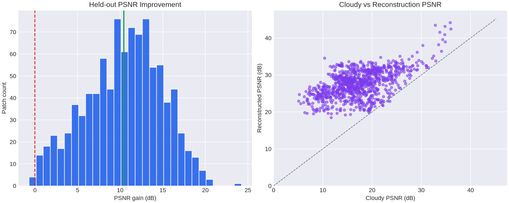
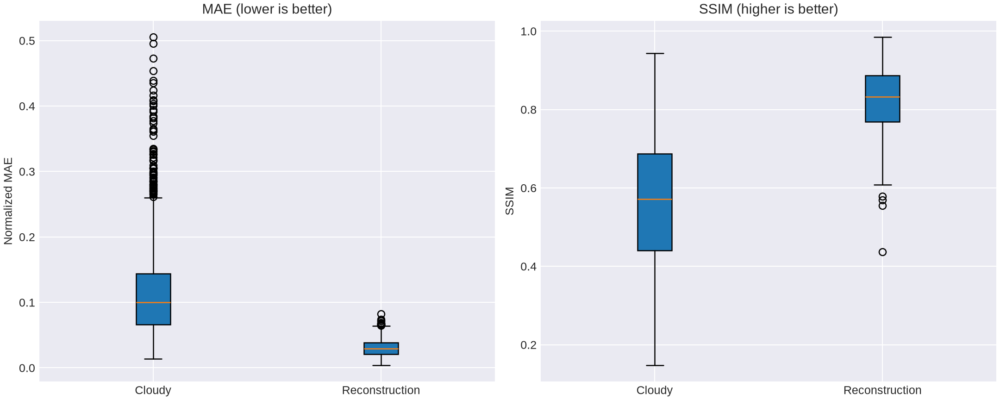
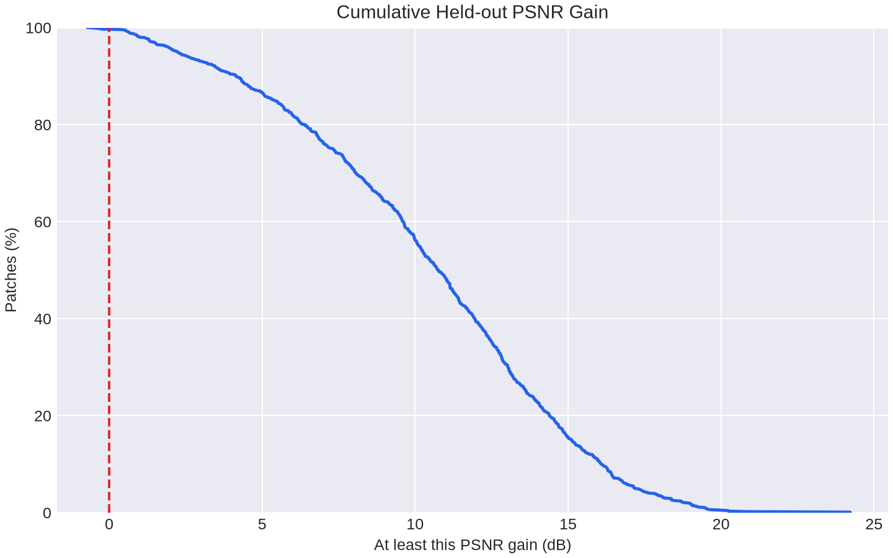

# ClearSky-AI Sentinel Held-out Benchmark

- Patches: 964
- Checkpoint SHA-256: `eac1a8b598de5739223d3aa11c9fad6e0e00f05427ddd6683ba7eca96d3a3a56`
- Cloudy mean PSNR: 17.25 dB
- Reconstruction mean PSNR: 27.65 dB
- Mean PSNR gain: +10.40 dB
- Patches with positive PSNR gain: 960/964
- Cloudy MAE: 0.11962
- Reconstruction MAE: 0.03130
- Cloudy SSIM: 0.56137
- Reconstruction SSIM: 0.82366
- Cloudy SAM: 14.045 degrees
- Reconstruction SAM: 8.970 degrees

## PSNR benchmark

The histogram shows how many patches achieved each PSNR gain. The scatter plot
compares cloudy and reconstructed PSNR. Points above the diagonal improved.

## MAE and SSIM benchmark

The MAE box plot shows average pixel error; lower is better. The SSIM box plot
shows structural similarity; higher is better.

## Cumulative PSNR gain

This curve shows the percentage of patches at or above each PSNR gain value.
The area to the right of zero represents improved reconstructions.

## Interpretation

These are paired-reference scores from SEN12MS-CR test patches. Clear references can be from a different acquisition date. The benchmark is not an independent external validation.

## Dataset split

- Training material: SEN12MS-CR and AllClear, with approximately 90 GB of source data used
- Training-split examples in the demo: 96 patches
- Validation split: not recorded in the prepared manifest or checkpoint
- Held-out test benchmark: all 964 official test-split patches
- DiffCR: source repository/reference implementation

The exact source-dataset training patch count and number of validation patches
used to create the bundled checkpoint are not stored in the checkpoint.
